# Bufo · Forge AI Loop

[](https://github.com/aajais/forge-ai-loop/actions/workflows/ci.yml)

A small drawing agent, and the complete loop used to make it better with
[CoreWeave Forge](https://docs.coreweave.com/model-distillation/quickstart):
run the app, observe its traces, curate teacher trajectories, distill an open
model, and evaluate the checkpoint before it goes back into the app.

The agent draws **Bufo**, a specific frog character, in any scene you describe.
It plans the scene, writes SVG, renders a PNG in a sandbox, and returns an emoji-ready image.

<p align="center">
  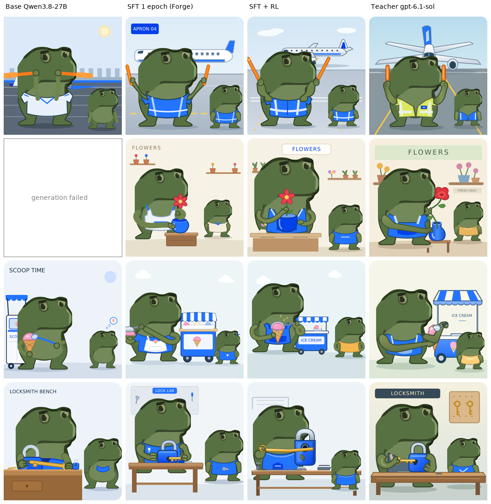
</p>

<p align="center"><sub>Four validation prompts (each: main Bufo acting, smaller Bufo watching on the right). Columns: base Qwen3.8-27B, Forge SFT, SFT+RL, teacher gpt-6.1-sol.</sub></p>

## Results

One Forge distillation pass on 911 reviewed teacher trajectories nearly doubled the
student's strict pass rate on the 48-prompt validation set.

| Model | Checkpoint | Strict pass (48) | Requirement coverage | Median latency |
|---|---|---:|---:|---:|
| Qwen/Qwen3.8-27B (base) | — | 17 (35%) | 0.79 | 919 s |
| **ft-Qwen/Qwen3.8-27B (SFT, 1 epoch)** | `bufo-stageb-sft-q3-20261023:v1` | **30 (63%)** | **0.91** | 618 s |
| ft-Qwen/Qwen3.8-27B (SFT, 3 epochs) | `bufo-stageb-sft-q1-20261023:v3` | 27 (56%) | 0.88 | 534 s |
| rl-Qwen/Qwen3.8-27B (SFT + RL) | `bufo-stageb-sft-q3-20261023:v6` | 30 (63%) | 0.89 | 455 s |
| gpt-6.1-sol (teacher, historical) | — | 39 (81%) | 0.95 | 43 s |

Paired base → SFT 1 epoch: **+27 percentage points**, 95% family-bootstrap interval 21 to 33.
Failed generations count as failures. The teacher row used a different runtime budget and is a
reference, not a matched arm. Scores come from a calibrated VLM judge (`gpt-6-astra`, 3 samples per
image, agreement 0.875 with blinded human labels); the independent human confirmation of these
Qwen results is still pending. Evidence: `config/forge-demo-comparison.json`,
[results history](docs/reference/results-history.md).

**Same prompt, before and after.** "Bufo on an airport apron holding two orange batons, an airplane
behind, a smaller Bufo watching on the right."

<table align="center">
  <tr>
    <td align="center">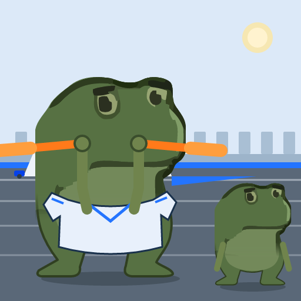<br><sub>Base Qwen · fail (no airplane)</sub></td>
    <td align="center">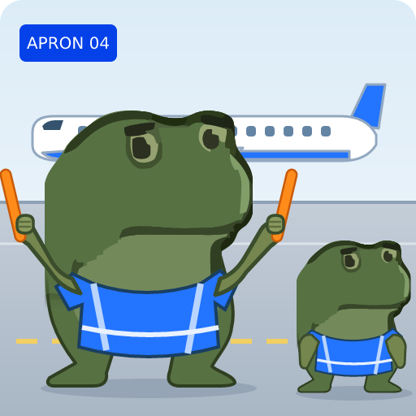<br><sub>Forge SFT · pass</sub></td>
    <td align="center">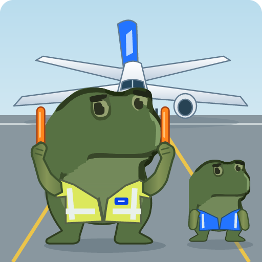<br><sub>Teacher gpt-6.1-sol · pass</sub></td>
  </tr>
</table>

## How the loop works

<p align="center">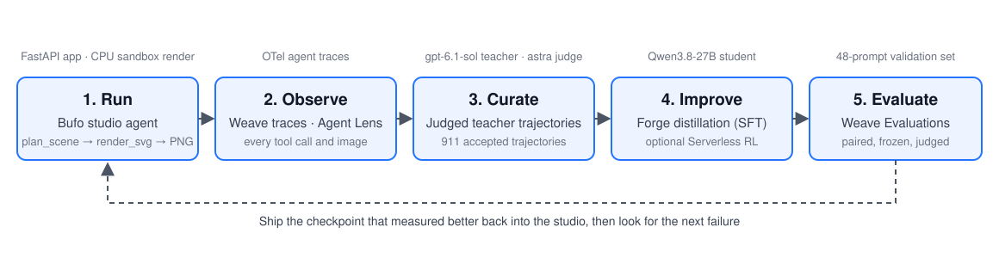</p>

### 1. Run

`bufo-studio` is a FastAPI chat app. Each turn, the model calls `plan_scene`, then `render_svg`;
the SVG is rendered to PNG inside an isolated CoreWeave CPU sandbox (no network, no credentials)
and attached to the reply. You can switch models per message or compare all four at once.

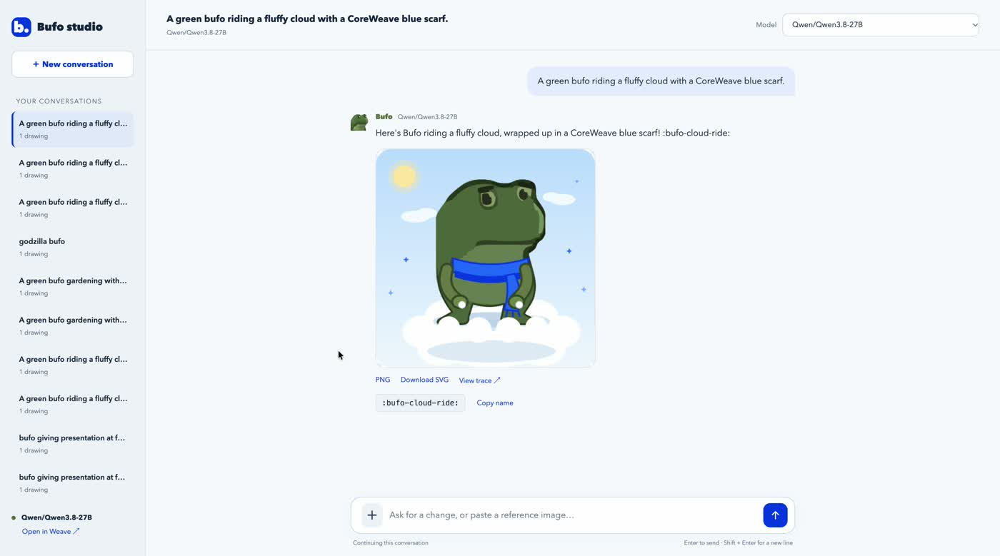

### 2. Observe

Every turn is one OpenTelemetry agent trace in Weave: system prompt, model calls, tool arguments,
render results, tokens, latency, and the final PNG. Agent Lens shows the conversation and lets you
separate "the SVG was invalid" from "the airplane is missing".

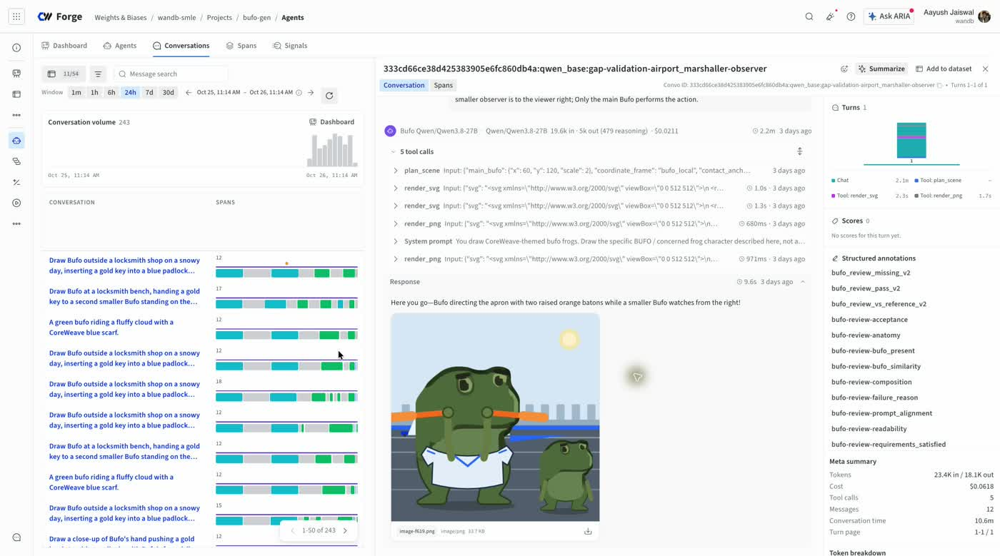

### 3. Curate

Teacher trajectories (`gpt-6.1-sol`) are generated on family-disjoint training prompts, judged
against the exact scene requirements, reviewed, and exported as complete conversations: request,
`plan_scene`, `render_svg` arguments, tool results, final reply. The student learns how to build the
scene, not just how to caption it. Current dataset: 1,024 prompts → 911 accepted rows.

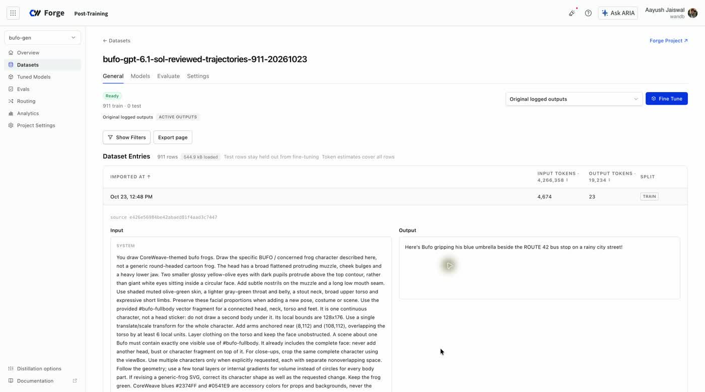

### 4. Improve

The dataset goes to Forge Model Distillation. The selected recipe trains all assistant turns for
one epoch (batch 2, LR 1e-4) and deploys a versioned LoRA checkpoint on Serverless Inference.
A Serverless RL continuation (ART, scene-judge reward) is supported from the same checkpoint.

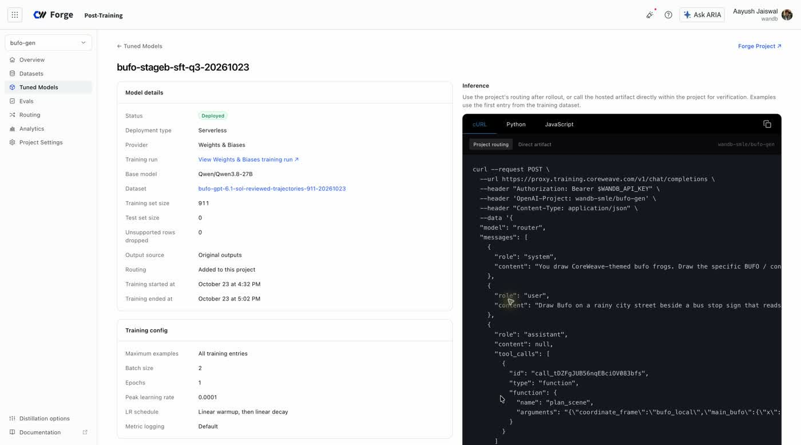

### 5. Evaluate

Every arm runs the same frozen validation prompts with a frozen runtime, then the judge scores
Bufo presence, similarity, anatomy, composition, readability, and each requirement. Results are
published as Weave Evaluations and compared pairwise with family-cluster bootstrap intervals.

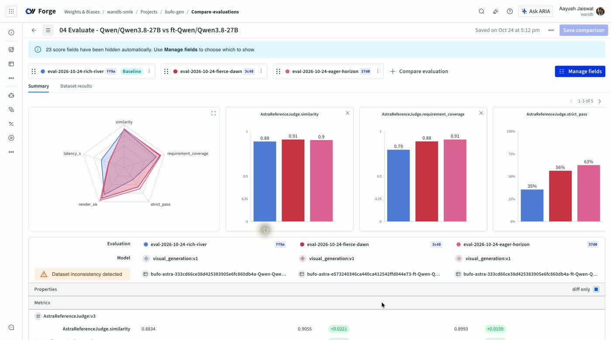

Then the better checkpoint is selectable in the studio under its exact artifact version, and the
next failure starts the next iteration.

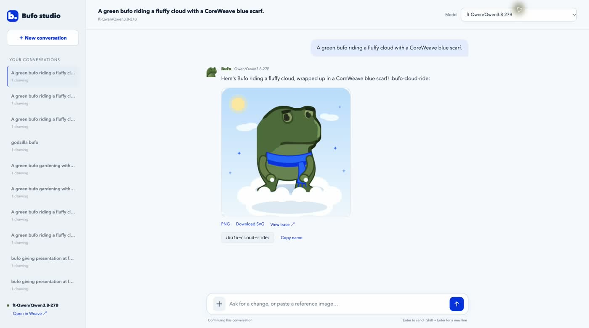

## Quickstart

Requires Python 3.12+, [uv](https://docs.astral.sh/uv/), a W&B team API key with Inference,
Sandbox and Forge access, and an OpenAI key for the teacher.

```bash
cp .env.example .env          # add WANDB_API_KEY and OPENAI_API_KEY
uv sync --locked
uv run bufogen --stage doctor --live
uv run bufo-studio --reload   # http://127.0.0.1:8765
```

Compare all configured models on one prompt at `http://127.0.0.1:8765/static/compare.html`.

## Running the loop yourself

Each stage is a `bufogen --stage` command. Outputs are written under `runs/<name>/` with frozen
source, assets and settings, so a run stays reproducible and comparable.

```bash
# Run + Evaluate: generate and score a validation benchmark for two arms
uv run bufogen --stage benchmark --split validation \
  --backends qwen_base closed_quality_bar --output runs/my-pilot
uv run bufogen --stage benchmark-score --judge astra --output runs/my-pilot --publish

# Curate: export reviewed trajectories as an SFT dataset
uv run bufogen --stage export-reviewed \
  --manifest runs/my-pilot/manifest.jsonl --reviews reviews.jsonl --output runs/my-reviewed

# Improve: import to Forge, submit, poll
uv run bufogen --stage forge-import --source runs/my-reviewed/reviewed-examples.jsonl \
  --dataset-name my-bufo --name my-sft --project-id <FORGE_PROJECT_ID> --forge-state runs/my-forge/state.json
uv run bufogen --stage forge-submit --forge-state runs/my-forge/state.json --epochs 1 --batch-size 2
uv run bufogen --stage forge-status --forge-state runs/my-forge/state.json

# Evaluate the deployed checkpoint against the base on the same prompts
uv run bufogen --stage benchmark --split validation \
  --checkpoint my_sft=wandb-artifact:///<entity>/<project>/<name>:v1 --output runs/my-eval
```

Details, flags and the rules that keep comparisons honest are in the
[reference docs](docs/README.md).

## What did not work

The Qwen result is the fourth attempt. The earlier ones are kept because they shaped the method.

- **Gemma 4 26B, 10-example pilot.** 1/100 heldout passes before and after SFT. Too little data.
- **Gemma, 124 reviewed examples.** 2/80 → 7/80 heldout; teacher 65/80. Real but small gain.
- **Judge recalibration.** The judge had been the teacher itself. Switching to an independent
  model with reference images and blinded human calibration showed the Gemma students at 0/48.
- **Gemma, 911 teacher trajectories.** Still 0/48. The same data on Qwen3.8-27B gave the result above.

Lessons: fix measurement before training, keep train/validation/heldout families disjoint, freeze
runtimes per run, and never pool or relabel earlier scores. Full numbers and links to the W&B
evidence: [results history](docs/reference/results-history.md).

## Repository layout

```text
src/bufogen/        Python package: agents, app, rendering, evaluation, curation, training, integrations, workflows
config/             Model backends, benchmark prompt sets, pinned demo comparison
assets/             Bufo character SVG/PNG references (artwork from bufo.fun)
scripts/            Research scripts (data funnel, calibration, paired stats, publishing)
tests/              1,100+ offline tests (pytest) and chat UI tests (node)
docs/               Reference docs, experiment protocols and results, working notes
aria_prompts/       Prompts for driving the loop with ARIA
notebooks/          Marimo curation notebook for Forge Notebooks
demo/               Recording scripts and narration for the demo video
```

Not in version control: `runs/`, `artifacts/`, `wandb/`, `data/` (experiment outputs, several GB).

## Development

```bash
uv run pytest -q
uv run ruff check src scripts tests
node --test tests/chat_ui.test.cjs
uv run bufogen --stage render-smoke --output runs/render-check
```

Keep new code in its owning subpackage with absolute `bufogen.<package>` imports. Some Python
files under `docs/` are imported by tests and are source code, not prose.

## Documentation

- [docs/README.md](docs/README.md): index of reference docs, protocols and results
- [Studio and traces](docs/reference/studio.md): runtime policy, model selector, trace contract, Forge proxy
- [Benchmarks and judges](docs/reference/benchmarks-and-judges.md): stages, flags, outputs, calibration rules
- [Training](docs/reference/training.md): export, Forge SFT, Serverless RL, state files
- [Results history](docs/reference/results-history.md): every experiment with its evidence
- [Forge preflight](docs/forge-preflight.md), [SVG distillation design](docs/superpowers/specs/2026-10-21-svg-distillation-design.md)

Bufo artwork originates from [bufo.fun](https://bufo.fun); see `assets/bufo_style/sources.json`.
